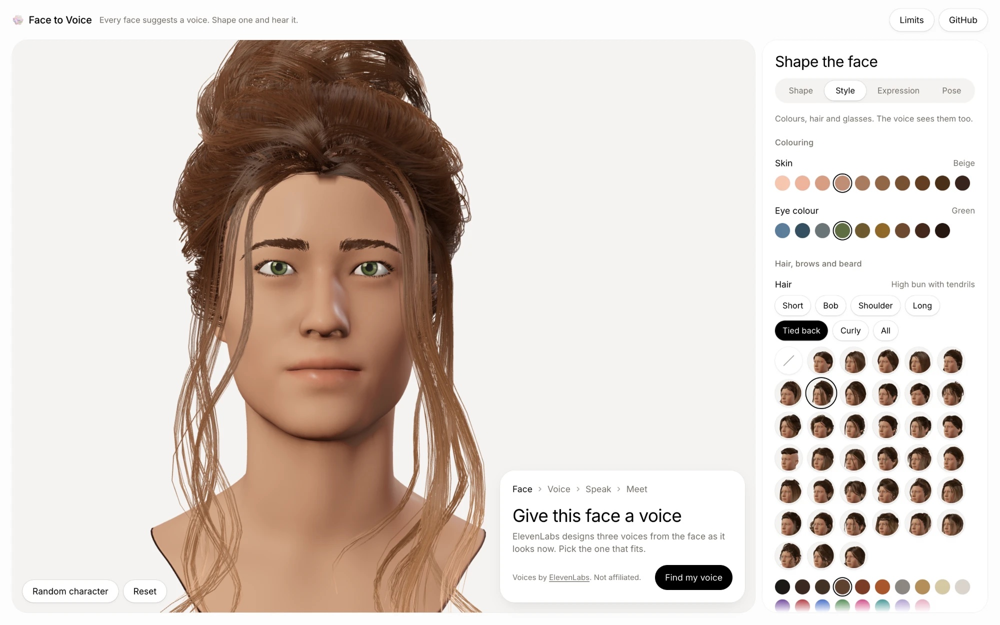

# Face to Voice

[](https://github.com/OliverA100/face-to-voice/actions/workflows/ci.yml)

**Try it: [facetovoice.com](https://facetovoice.com)**

A voice is hard to put into words. "Warm, a little gravelly, middle-aged" could be a hundred different people. But it's
often easy to picture the person whose voice you're after: their face, their age, their hair, the look they're giving
you. Face to Voice lets you start from that picture.

Shape a realistic 3D head, style it and give it an expression. Claude reads the face like a casting director,
ElevenLabs designs three voices to match, and the head lip-syncs to every line it speaks. Then meet the character and
talk to them out loud: they answer live, in their own voice, with the face moving as they speak.



The head is Google's [GNM Head](https://github.com/google/GNM), a linear statistical model of the human head,
exported to the browser as glTF morph targets. Everything on top of it (semantic sliders, a geometry limiter, strand
hair, add-ons, expressions, the voice pipeline and lip sync) is this repository.

**Contents:** [How ElevenLabs is used](#how-elevenlabs-is-used) · [Highlights](#engineering-highlights) ·
[How it works](#how-it-works) · [Known limitations](#known-limitations) · [Run it](#run-it) ·
[Responsible AI](#responsible-ai) · [Credits and licences](#credits-and-licences) · [Architecture](docs/ARCHITECTURE.md)

## How ElevenLabs is used

| | |
|---|---|
| **Voice Design from the face** | `eleven_ttv_v3`, with a description built from Claude's casting by a fixed template. The preview text is the character's own line, so all three previews already sound in character. |
| **Text to speech** | `eleven_v4_turbo` as `pcm_24000` with timestamps, the expression riding along as an audio tag. The server reads the whole line, times it, caches it in Vercel Blob and sends it to the browser as NDJSON: the words' phonemes, the aligned times, then the audio. First audio about a second after the request for a new line, under 0.1 s for a line said before. |
| **Forced Alignment → lip sync** | Each new line is timed by Forced Alignment on its own audio before it plays: v4 Turbo's character stamps spread a word's letters evenly and can put a word ~0.2 s off. Closures (p/b/m, f/v, th) and vowels are then snapped to the audio itself. Live chats use the word timings from the dialogue websocket instead. |
| **Live conversations** | A LiveKit agent answers as the character with Claude Haiku 5.5 and speaks in their designed voice over the text-to-dialogue websocket. |
| **Cost and limits** | A design is never paid for twice (voices cached per description, spoken lines in Vercel Blob). Saved voices live in a small pool sized to the plan, with a studio voice as the fallback. Every paid call has a daily cap, and picking voices is limited per browser. |

More: [voice and lip sync](docs/ARCHITECTURE.md#voice-and-lip-sync), [live conversations](docs/ARCHITECTURE.md#live-conversations).

## Engineering highlights

- **Fast:** the head is on screen in under half a second on desktop and under a second on a throttled phone.
- **Smooth:** 60 fps on a phone profile while dragging sliders, switching emotions and speaking.
- **Only impossible faces are blocked:** weird faces are fine, skin through the eyeball isn't. A stress test checks
  thousands of app states exactly.
- **Tested:** over 500 tests (web, agent and pipeline) run in CI on every push.

All the numbers and how they were measured: [docs/ARCHITECTURE.md](docs/ARCHITECTURE.md#numbers).

## How it works

```
 pipeline/ (Python, offline)                     web/ (Next.js, React Three Fiber)
 ───────────────────────────                     ───────────────────────────────────────────────
 GNM Head (253 identity + 383 expression          head.glb + head.extra.glb (morph targets)
   components, numpy)                               │  sliders write morph weights, no React renders
   ├─ export: parts, morph targets, meshopt   ──►   │  vertex limiter blocks impossible geometry
   ├─ semantic sliders solved on the model          │  strand hair + add-ons follow the skin
   ├─ slider ranges vs adult anthropometry          │  expression, pose, idle life, age wrinkles
   ├─ limiter data + automated stress test          ▼
   └─ hair, brows, lashes, beards, glasses      screenshot + look ──► /api/voice/design
                                                       Claude casts the character (structured output)
                                                       ElevenLabs Voice Design → 3 previews
                                                 pick one ──► /api/voice/select (save, voice pool)
                                                 speak    ──► /api/voice/speak
                                                       eleven_v4_turbo line, timed by Forced Alignment
                                                       ──► Web Audio + viseme cues ──► mouth morphs
                                                 meet     ──► /api/character/profile
                                                       Claude writes who the character is
                                                 chat     ──► /api/talk/token ──► LiveKit room
                                                       agent/ (Node): speech-to-text → Claude Haiku 5.5
                                                       → ElevenLabs v4 Turbo in the character's voice
                                                       ──► live lip sync, the reply's mood on the face
```

**The head.** GNM is linear, so each component bakes into an exact glTF morph target. The 33 **Shape** sliders (jaw
width, eye spacing, lip fullness …) are directions solved on the model, each moving its own measurement while holding
the others, with ranges checked against adult anthropometry. [More](docs/ARCHITECTURE.md#pipeline--morph-targets)

**Only impossible faces are blocked.** Exact checks in the pipeline find what breaks, and a fast mirror in the app
turns each slider's track into "as far as this face allows". [More](docs/ARCHITECTURE.md#the-limiter-and-the-stress-test)

**Hair and add-ons.** 228 strand hair styles drawn on the GPU, every root tied to the skin so hair follows sliders,
blinks and expressions. Eyebrows, lashes, beards and glasses come from the pipeline.
[More](docs/ARCHITECTURE.md#hair-and-add-ons)

**Expression and voice.** Twelve emotions from GNM's ExpressionSampler. Claude casts the character from a screenshot
into a fixed schema, a template turns that into the Voice Design prompt, and the chosen take speaks with lip sync
placed on the audio. [More](docs/ARCHITECTURE.md#voice-and-lip-sync)

**Meet and talk.** Claude writes the character once per voice: a name, a backstory and a greeting that drops you into
a scene. "Chat" starts a live voice conversation with them. [More](docs/ARCHITECTURE.md#live-conversations)

**Export.** "Download character" builds a zip in the browser: a transparent portrait, the casting and voice prompt,
the chosen take, the profile, a rebuild link and a licence file. [More](docs/ARCHITECTURE.md#export)

## Known limitations

- **Lip sync reads English.** Visemes come from English letter-to-sound rules, so a line typed in another language is
  voiced but mouthed as if it were English.
- **A voice can't be recreated from its description.** Voice Design is not reproducible from a seed, so the app caches
  the voices it designed for each description, and the export carries the chosen take's audio and its prompt, not a
  voice you can reuse elsewhere.
- **Few voices are kept.** Saved voices live in a small pool sized to the ElevenLabs plan, and the least recently used
  are dropped; when the day's saves or the month's voice operations run out, visitors get the closest pre-designed
  studio voice.
- **The limiter only knows what it has been shown.** Single sliders and slider pairs never break in the stress test,
  but 3 of 3,000 random multi-slider faces still cross somewhere, and some extreme faces in motion cross by up to
  1.2 mm. Each failure found is added to the limiter's data.
  [Numbers](docs/ARCHITECTURE.md#the-limiter-and-the-stress-test)
- **A head, no body.** The model is a head; there are no shoulders, and slider ranges are checked against adult
  anthropometry only.
- **Hair doesn't move on its own.** The 228 styles follow the skin (sliders, blinks, expressions) but have no physics:
  no swing, no gravity.
- **Most hair is non-commercial.** 223 of the 228 styles are CC BY-NC 4.0, and a character exported with one of them
  is too (see [Credits and licences](#credits-and-licences)).
- **Phone numbers are emulated.** Frame rates and timings come from a desktop with 4× CPU throttling; an older phone's
  GPU may struggle with long hair at full resolution.
- **Live conversations are limited:** English only, five at a time, three minutes long and a set number a day across
  the site. The character is an AI: it is told to stay in character and within the rules, but it can still say
  something odd.
- **The image check is shallow.** The voice route checks that it got a small same-origin JPEG, not that it is a render
  of this app. [Responsible AI](docs/responsible-ai.md)

## Run it

Requirements: Node 22.18+ (24+ for the agent), pnpm, and for the pipeline Python 3.13 with [uv](https://docs.astral.sh/uv/).

```bash
cp .env.example web/.env.local     # FTV_MOCK_ELEVENLABS=1 and FTV_MOCK_CLAUDE=1 run everything without keys
cd web && pnpm install
pnpm fetch-hair                    # the 228 hair styles (~220 MB), not in git
pnpm dev                           # http://localhost:3000
```

- **Without keys**, with both mocks on, everything runs: every slider, styling, expression, pose, the voice flow
  (generated tones with lip sync) and export. A real casting needs `ANTHROPIC_API_KEY` (about a cent per face); Voice
  Design needs an ElevenLabs paid plan (Starter is enough). `FTV_SAVED_VOICES=1` alongside the mocks lets Speak use
  the saved studio voices for real speech, still designing no new voices.
- **Without the hair files** the app works bald, and the hair panel says how to get them.
- **Live conversations** need a LiveKit project (`LIVEKIT_URL`, `LIVEKIT_API_KEY`, `LIVEKIT_API_SECRET`) and the agent
  running; [agent/README.md](agent/README.md) says how, including a canned agent that needs no other keys. Chat shows
  with `TALK_PUBLIC=1` and `NEXT_PUBLIC_TALK_PUBLIC=1`, or for invited visitors (`/?talk=<code>`, `TALK_INVITE_CODES`).
- Debug views: `?perf=1` (fps, draw calls, load timings) and `?lipsync=1` (viseme timeline).

```bash
cd web && pnpm test && pnpm lint && pnpm typecheck
cd agent && pnpm test && pnpm typecheck
cd pipeline && uv sync && uv run pytest && uv run ruff check && uv run verify
```

## Repository layout

| Folder | What it is |
|---|---|
| `web/` | Next.js 16 app: `src/components/scene` (React Three Fiber), `src/components/ui` (panel, voice card, character card, chat), `src/lib/morphs` (morph store, limiter, random faces), `src/lib/lipsync` (recorded and live), `src/lib/talk` (the conversation in the browser), `src/lib/server` (Claude, ElevenLabs, LiveKit tokens, caches, limits), `src/lib/export` |
| `agent/` | The LiveKit agent that plays the character in a live conversation (Node, TypeScript). See [agent/README.md](agent/README.md) |
| `pipeline/` | Python tools: GNM export and verification, semantic sliders, ranges and validation, emotions, hair and add-ons. See [pipeline/README.md](pipeline/README.md) |
| `docs/` | [architecture](docs/ARCHITECTURE.md), [responsible AI](docs/responsible-ai.md), [design tokens](docs/design.md) |
| `third_party/` | Licences of bundled third-party work (see `NOTICE`) |

## Responsible AI

The characters are synthetic heads, and the casting leans into stereotypes on purpose, the way game casting does. The
guard rails: Claude must never name or guess a real person; no voice is cloned (Voice Design creates new voices from a
text description); no free text from the browser reaches a prompt, except a visitor's own speech in a live
conversation, which only ever reaches their own conversation; every paid call has a daily cap, and picking voices is
limited per browser.
Details: [docs/responsible-ai.md](docs/responsible-ai.md).

## Credits and licences

Code: MIT ([LICENSE](LICENSE)). Third-party work and the licence of every shipped asset: [NOTICE](NOTICE).

- **Head model:** [GNM Head v3.0](https://github.com/google/GNM) by Google LLC, Apache License 2.0. Ploumpis et al.,
  *GNM Head: A Generative aNthropometric Model of the human head*, arXiv:2607.23687.
- **Hair:** 223 styles from [HairCS](https://huggingface.co/datasets/HairCS2027/HairCS) (Lu et al., arXiv:2609.16465),
  **CC BY-NC 4.0, non-commercial only**; 4 from Daniel Bystedt's Blender "Hair Styles" demo, CC BY-SA 4.0; 1 procedural
  groom of our own, MIT. An exported character with HairCS hair is non-commercial; its zip says so.
- **Add-ons:** generated here (MIT). MakeHuman's CC0 brow cards and four community beards serve as shape guides only.
- **Lip sync:** English letter-to-viseme rules adapted from [TalkingHead](https://github.com/met4citizen/TalkingHead)
  by Mika Suominen, MIT.
- **Controls** inspired by Google's [XR Blocks GNM demo](https://github.com/google/xrblocks/tree/main/samples/avatar_lab/gnm)
  (ideas only, no code).
- **Voices and speech** by [ElevenLabs](https://elevenlabs.io); casting, slider names, character profiles and the
  character in a conversation by [Claude](https://www.anthropic.com/claude).
- **Live conversations** on [LiveKit](https://livekit.io) (LiveKit Agents, Apache 2.0, and LiveKit Cloud); speech to
  text by AssemblyAI through LiveKit Inference.

This is an independent project, not affiliated with or endorsed by ElevenLabs, Google, Anthropic or LiveKit.
